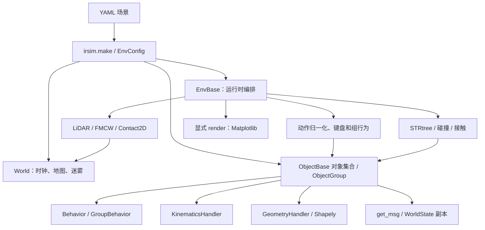
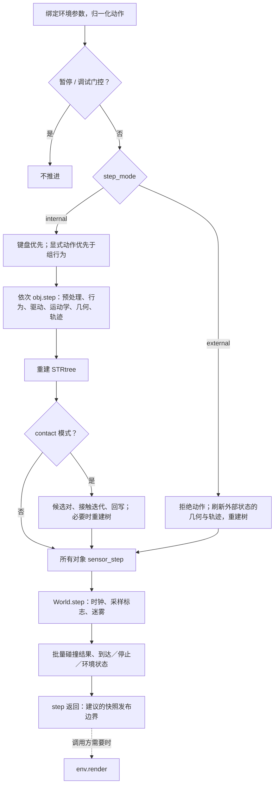

# IR-SIM 架构评审

> 状态：代码分析与设计基线，尚未实施性能重构或 MCP 服务。分析日期：2026-10-24。上游：`hanruihua/ir-sim`，提交 `39ed2f0e4ca006f5061d8808b19b46b2cfff2fca`，包版本 `2.12.0`。后续引用均以这个提交为准。

## 1. 结论与适用范围

IR-SIM 是一个 YAML 驱动、以 Python 对象为主要状态载体的平面机器人仿真库。它适合导航、行为、控制和学习算法的快速验证。`EnvBase` 编排时序，`ObjectBase` 汇集对象状态和组件，算法层已经混合使用标量代码、NumPy 批处理和 Shapely 几何运算。

**可以引入 ECS 思路和数组运算，但当前最值得优先实施的是消除重复遍历、建立清晰的帧边界和按场景选择批处理路径。** 现有代码已经批量检测碰撞、向量化 LiDAR 射线计算，并提供组 SFM。把 Python 类改名为 Entity／Component 不会自动改善这些成本。

**可以为本地 Gemma 提供 MCP 读取和分析能力。** 已有 `get_msg()` 能复制出世界快照，应在仿真线程完成一步后使用它，由桥接层发布，MCP 提供有界查询，Agent Host 调用本地模型分析。模型服务、MCP 服务和仿真运行时是三个职责。接入 MCP 不要求先完成 ECS。

本文覆盖环境构建、对象生命周期、行为、运动学、几何／地图、碰撞／接触、传感器、消息、渲染和扩展接口。代码审阅覆盖主要运行路径及相应测试；不是对全部算法数学正确性、所有平台和所有示例的认证。性能数据及模型探测的实际结果单列在[证据说明](evidence/README.md)，设计提案分别见 [ECS／数组方案](ecs-array-plan.zh-CN.md)和 [MCP／Gemma 方案](mcp-gemma-plan.zh-CN.md)。

## 2. 系统边界与模块职责

基线包含 77 个包内 Python 文件、23,310 行源码（含注释和空行）、16 个 `test_*.py` 文件、26 个 usage 子目录。文件数量不代表完整度，以下以实际调用关系为依据。

| 层／目录 | 实际职责 | 主要边界 |
| --- | --- | --- |
| `irsim/__init__.py` | `_EnvFactory`、`make()`，选择 2D／3D 环境，传入配置和模式 | 公共构建入口 |
| `env/env_config.py` | `safe_load` YAML、可选 `irsim` 根键、构建 World／对象／分组／绘图对象 | 配置解释和场景重建 |
| `env/env_base.py` | 步进、输入优先级、空间索引、接触求解、传感器阶段、状态、消息、增删对象 | 运行时编排中心 |
| `world/world.py` | 世界参数、仿真时钟、采样节奏、网格地图和迷雾更新 | 不是所有碰撞计算的拥有者 |
| `world/object_base.py` | 状态、速度、目标队列、限速／加速度、处理钩子、组件、缓存、轨迹、状态判定 | 主要可变数据拥有者 |
| `world/object_factory.py` | 分布生成、机器人／障碍物构建、地图对象构建 | 角色与运动学组合 |
| `lib/handler/` | 运动学和几何模型的工厂／注册、维数和坐标转换 | 独立于角色的模型适配 |
| `lib/behavior/` | 单对象及组行为，函数／类注册，dash／RVO／SFM／ORCA | 控制意图生成 |
| `lib/algorithm/` | 运动学、RVO、SFM、射线、接触数值内核 | 已存在多处数组化 |
| `world/sensors/` | LiDAR／FMCW LiDAR／Contact2D | 读取对象与场景，保存每步传感结果 |
| `world/map/` | 占据栅格、地图边界索引、地图生成、FogMap | 地图内部也有空间数据结构 |
| `env/env_plot*.py`、`world/object_plot.py`、`gui/` | Matplotlib artist 更新、输入和保存 | 可与计算分开计时 |
| `msg/messages.py` | ROS 风格 dataclass、独立数组副本、字典转换 | 可重用的读取边界 |
| `lib/path_planners/` | A*／JPS、RRT 系列、PRM | 通常由调用方主动运行，不是每个 tick 自动执行 |
| `config/`、`util/random.py` | 环境实例参数、兼容模块代理、RNG | 有实例隔离，也保留进程级绑定 |

`robots/` 下仍有兼容类，但工厂对常见运动学通常直接返回装配了 Handler 的 `ObjectBase`；不能把实际架构理解为“每种机器人都通过深层继承覆盖 step”。`World3D` 增加 z 范围，`EnvBase3D` 提供 3D 绘图包装；核心运动学、Shapely 碰撞和 LiDAR 仍是平面模型。不能据此宣称已有完整 3D 刚体物理。[S1] [S2] [S3] [S4]

## 3. 构建与生命周期

1. `make()` 将投影、`step_mode` 等交给环境构造函数。
2. `EnvBase` 创建自己的 `EnvParam`、`WorldParam`、PathManager 和可选 seeded RNG，再绑定兼容模块代理。
3. `EnvConfig` 解析 YAML；工厂构建 robot、obstacle、map，并按对象 ID 排序，按组建立 `ObjectGroup`。地图不加入行为组。
4. 环境给对象挂接 `_env`，建立 STRtree，绑定对象列表，运行第一次传感器更新，检查名称唯一性。
5. 非 headless 模式创建绘图和输入组件；headless 不创建 figure。`display=False` 仍可创建离屏绘图，性能基准需要明确用 `headless=True`。
6. `reset()` 恢复初始状态；`reset(random=True)` 从缓存配置重建并重新采样；`reload()` 可以重新读 YAML。重建会重新发放对象 ID。

这决定了两项扩展约束：数组槽位不能当作公开 ID；MCP 必须在 reset／reload 后更新 epoch，避免把旧对象 ID 当作同一个实体。名称适合展示和跨系统匹配，但只有在对应场景生命周期内满足唯一性，不能替代 session／epoch。[S2] [S5]

## 4. 一个 tick 的准确顺序

`EnvBase.step()` 的实际流程如下。这里区分计算步骤和调用方显式触发的渲染。

单对象运动步骤中，静止或已经停止的对象会清零速度并提前返回；运动对象执行 `pre_process → gen_behavior_vel → _drive_response → kf.step → mid_process → gf.step → 缓存失效 → post_process → 轨迹记录`。EnvBase 传入 `sensor_step=False`，等全部运动和接触处理完成后统一更新传感器。[S2] [S5]

两个容易被重构改变的语义：

- **单对象行为的观测是顺序的。** 前一个对象的 `_state` 已回写后，下一个对象的行为可以读到它。因此不是所有行为都从同一份 tick 开始状态计算。
- **组行为提前产生动作。** 组 SFM 先收集成员状态再整体计算，同一组成员共享快照；多个组仍依次调用。它与逐对象 SFM 的更新语义不能直接视为相同。

状态检查发生在时钟更新之后；在 `step()` 中途抓数组，会出现位置、传感器、碰撞标记和时间戳来自不同阶段的组合。`get_msg()` 的复制能力本身不提供并发原子性，调用时机仍由桥接层保证。

## 5. 组件与数据所有权

`ObjectBase` 目前是一个较大的聚合对象，装配 `kf`、`gf`、`obj_behavior`、传感器、Contact2D 和 ObjectPlot。运动模型处理行为动作，几何模型变换原始形状；目标使用队列，轨迹持续追加数组副本。状态维数与动作维数依运动学而异：diff／omni 常见状态 3 维、动作 2 维，omni_angular 动作 3 维，Ackermann 常见状态 4 维，passive 的速度为世界坐标 `[vx, vy, yaw_rate]`。[S5] [S6]

`obj.state`、`obj.velocity` 和部分直接 scan getter 暴露可变数组。`set_state()` 会同步几何、有效性和缓存，而调用方直接改数组可能绕过这些动作。数组运行时如果再维护一份权威状态，就必须解决同步方向、脏标记、视图失效和 setter 兼容问题。

`get_msg()` 则经 `WorldState.from_env → ObjectState.from_object` 复制状态及扫描数组，可保留稳定的历史记录。它已有对象 ID／名称、角色、运动学、形状、里程计、目标、到达／碰撞、接触和多扫描消息。消息没有完整地图、全部配置、FOV 命中结果，也没有包含 FMCW 扩展字段的完整通用传感器协议；这些需要按需增加桥接投影，不能宣称现成快照已涵盖全部运行时。[S7]

## 6. 已有加速能力与仍然存在的成本

| 路径 | 基线已经实现 | 候选工作 |
| --- | --- | --- |
| 碰撞状态 | 一次树查询收集候选，NumPy 掩码过滤，`shapely.intersects` 批处理；地图走专门测试 | 复用稳定的元数据和几何数组，按实测决定是否拆静态／动态索引 |
| LiDAR／FMCW | 共享 `cast_rays`，数值射线／线段运算；每块 1024 条线段限制矩阵大小 | 复用静态边界线段、减少每传感器重提取几何；保持 hit owner 和 tie 顺序 |
| SFM | `SocialForceModelBatch` 对组成员批量运算 | 当前仍构造密集成对矩阵；考虑分块和精确邻域候选 |
| RVO | 候选速度筛选／penalty 已有向量化；邻居数据有缓存 | 仍有逐对象邻居扫描、锥构建和线障碍循环 |
| 接触 | 候选批量 broad phase；求解器内缓存凸分片与数组位移，最后回写 | 约束求解保留有序迭代；先优化局部内核和候选，不能任意全并行 |
| 对象调度 | 行为、运动学和几何 Handler 可扩展 | 许多小数组、Python 方法调用、重复列表和元数据收集 |
| 渲染 | 2D artist 更新和静态元素复用；headless 可跳过 | 计算与 render 分别计时，ECS 不会直接加速 Matplotlib |
| 消息 | 独立副本和 ROS 风格结构 | 完整快照及 to_dict 的复制／展开成本，默认应提供摘要 |

代码定位：[S2] [S8] [S9] [S10] [S11]。不要用早期版本的“逐对 Shapely 碰撞”和“逐射线 GEOS overlay”描述当前基线。

## 7. 具体架构问题与优先级

### P1：无条件构造外部对象列表

`gen_behavior_vel()` 在调用普通行为时传入 `self.external_objects`；该属性遍历全部对象并按 ID 排除自身。`dash` 等不使用邻居的行为仍支付这个成本。N 个活动对象每步形成 O(N²) 的 Python 遍历。诊断中 1000 对象、5 步出现约一千万次 ID getter 调用，调用结构与源码一致。[S5]

建议为内置行为声明是否需要外部对象，或引入惰性只读查询对象；自定义行为保留现有外部列表语义。不能直接全局删掉参数，因为插件可能使用它。

### P1：批量动作目标解析反复搜索

`normalize_actions → _target_positions → position` 对每个 ID／名称调用 `find_object_by_identity`，再调用 `objects.index`。大量目标动作的路径为 O(KN)，K 接近 N 时同样为平方级。目标映射按一次调用建立即可降为 O(N+K)，同时必须保持未知 ID 报错、名称匹配、重复目标和删除后非连续 ID 的行为。[S12]

### P1：大规模 SFM 的密集临时矩阵

组 SFM 使用 `[N, N+M, 2]`、`[N, N+M]` 数组，距离过滤发生在分配之后。设置 `neighbor_threshold` 并不会让当前实现的内存分配自动变为稀疏。墙体力还有 `[N, segment_count, 2]` 计算。应先考虑固定内存上限的分块，再评估空间候选带来的算法复杂度改善。[S10]

### P1：并发读取缺少正式帧边界

模块参数代理有进程级 `_current` 绑定，RNG 也经该绑定选择。现有实例状态支持同进程交错步进；名为 `test_concurrent_step_isolated` 的测试实际顺序调用两个环境，不能证明多线程并行安全。MCP handler 不应从任意线程直接访问或驱动 EnvBase。建议一个 worker 拥有一个环境，tick 结束发布不可变快照，跨 worker 用 spawn 进程隔离。[S13]

### P2：几何、对象和数组之间的重复转换

动态几何每步做刚体变换；LiDAR 为每个传感器提取候选对象边界，适合按 geometry version 缓存静态线段。空间树不可原地增删；静态／动态索引拆分可以减少重建规模，但需要维护“树返回位置 → 对象 ID”映射，且是否有收益取决于静态比例和查询成本。[S8] [S9][E1]

### P2：长运行数据保留策略

轨迹逐步追加，完整消息包含多个扫描字段。实时 Agent 场景应有有界轨迹窗口、按需求取扫描和日志保留期限。默认用户可见行为是否改变，需要在后续单独决策；本阶段没有修改保留策略。

## 8. 架构决策记录

| 决策 | 采用原因 | 后果 |
| --- | --- | --- |
| 保留 YAML 与公共 ObjectBase API，渐进引入批处理 | 避免插件和 usage 全部迁移 | 初期 pack／writeback 成本必须纳入计时 |
| 优先处理重复遍历、SFM 分块和静态几何复用 | 有直接源码和诊断证据 | 在完整 ECS 之前即可评估收益 |
| 旧顺序行为作为默认参考语义 | 用户可能依赖当前轨迹 | 同步观测语义须显式 opt-in，不能静默切换 |
| MCP 从公开消息接口出发 | 独立副本与现成语义较成熟 | 需增加版本、摘要、传感器扩展和一致性边界 |
| 仿真 worker 为唯一写入者，读取服务只读 | 保护完整 tick 和可复现性 | 服务进程通过快照／队列通信 |
| 先做 Host 主动取数并交给 Gemma | 不依赖模型原生工具选择 | 原生 tool calling 通过实际能力探测后再启用 |
| 首版不把 GPU ECS 与 GPU LLM 绑定 | 当前仿真主要是 CPU＋GEOS，本机 GPU 还运行模型 | 先比较 CPU NumPy／分块；GPU 路线另行基准 |

## 9. 可核查源码与外部资料

以下链接固定到审阅提交。外部规范用于支持协议／库的能力说明；工程设计与优先级是本评审的判断。

- [S1：make 与投影工厂][S1]
- [S2：EnvBase，特别是 step、批量碰撞、contact、build_tree、get_msg][S2]
- [S3：工厂构建规则][S3]
- [S4：EnvBase3D 包装][S4]
- [S5：ObjectBase 状态、step 和 external_objects][S5]
- [S6：KinematicsHandler 及 passive 模型][S6]
- [S7：WorldState／ObjectState／LaserScan][S7]
- [S8：射线内核与线段分块][S8]
- [S9：LiDAR 场景查询与扫描几何][S9]
- [S10：SFM 标量与批量内核][S10]
- [S11：有序接触求解器][S11]
- [S12：动作归一化与目标查找][S12]
- [S13：环境隔离测试，含实际顺序执行的 concurrent 测试][S13]
- [E1：Shapely 2.1.2 STRtree][E1]，查询树不能在构建后增删节点，基线锁定的 Shapely 是 2.1.2。

[S1]: https://github.com/hanruihua/ir-sim/blob/39ed2f0e4ca006f5061d8808b19b46b2cfff2fca/irsim/__init__.py
[S2]: https://github.com/hanruihua/ir-sim/blob/39ed2f0e4ca006f5061d8808b19b46b2cfff2fca/irsim/env/env_base.py#L337
[S3]: https://github.com/hanruihua/ir-sim/blob/39ed2f0e4ca006f5061d8808b19b46b2cfff2fca/irsim/world/object_factory.py#L168
[S4]: https://github.com/hanruihua/ir-sim/blob/39ed2f0e4ca006f5061d8808b19b46b2cfff2fca/irsim/env/env_base3d.py
[S5]: https://github.com/hanruihua/ir-sim/blob/39ed2f0e4ca006f5061d8808b19b46b2cfff2fca/irsim/world/object_base.py#L666
[S6]: https://github.com/hanruihua/ir-sim/blob/39ed2f0e4ca006f5061d8808b19b46b2cfff2fca/irsim/lib/handler/kinematics_handler.py
[S7]: https://github.com/hanruihua/ir-sim/blob/39ed2f0e4ca006f5061d8808b19b46b2cfff2fca/irsim/msg/messages.py#L451
[S8]: https://github.com/hanruihua/ir-sim/blob/39ed2f0e4ca006f5061d8808b19b46b2cfff2fca/irsim/lib/algorithm/ray_casting_2d.py
[S9]: https://github.com/hanruihua/ir-sim/blob/39ed2f0e4ca006f5061d8808b19b46b2cfff2fca/irsim/world/sensors/lidar2d.py#L185
[S10]: https://github.com/hanruihua/ir-sim/blob/39ed2f0e4ca006f5061d8808b19b46b2cfff2fca/irsim/lib/algorithm/social_force_model.py#L327
[S11]: https://github.com/hanruihua/ir-sim/blob/39ed2f0e4ca006f5061d8808b19b46b2cfff2fca/irsim/lib/algorithm/contact.py#L605
[S12]: https://github.com/hanruihua/ir-sim/blob/39ed2f0e4ca006f5061d8808b19b46b2cfff2fca/irsim/util/decorator.py#L62
[S13]: https://github.com/hanruihua/ir-sim/blob/39ed2f0e4ca006f5061d8808b19b46b2cfff2fca/tests/test_env.py#L1237
[E1]: https://shapely.readthedocs.io/en/2.1.2/strtree.html
