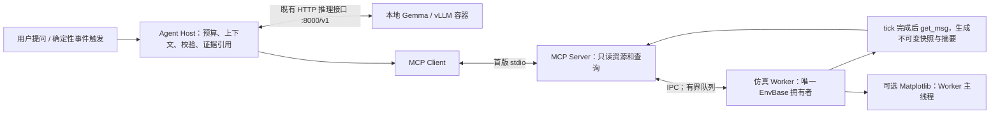

# MCP 与本地 Gemma 实时分析方案

> 状态：设计提案。已完成本机模型 HTTP 能力探测；尚未实现 MCP Server、Agent Host 或持续运行的桥接服务。不要把下面的拟议接口当作现成可调用 API。

## 1. 可行性与“实时”的定义

可以让本地 LLM 按需读取最新完整仿真帧，分析轨迹、碰撞、接触、传感器和场景配置，也可以扩展只读源码查询。推荐采用**仿真独立推进、确定性程序提取事实、LLM 异步解释**的方式。

IR-SIM 默认仿真步长是 0.1 s；能否按墙钟维持 10 Hz 取决于场景。MCP 是上下文和工具协议，不是硬实时调度器。本次 Gemma 摘要问答耗时约 19.9 s，所以当前模型适合用户询问、异常复盘和低频建议；不能把它的调用阻塞在每次 `env.step()` 中。

必须区分四个时间：仿真帧的 `sim_time`、帧被采集的墙钟时间、开始推理的时间、回答完成的时间。LLM 回答时引用的帧可能已经过时；答案必须携带帧标识和年龄，而不是声称“现在仍在发生”。

## 2. 本机已验证的模型条件

2026-10-24 从 Docker 发现既有 `gemma4-vllm` 容器，原状态为停止。使用原配置临时启动并测试，结束后恢复停止状态；没有修改模型项目、环境文件或容器配置。

| 项目 | 本次观察 |
| --- | --- |
| 推理服务 | vLLM `0.22.1`，通过 Docker／WSL GPU 运行 |
| 模型来源 | `google/gemma-4-E2B-it` |
| 服务模型名 | `gemma-4-e2b-it` |
| HTTP 地址 | `http://127.0.0.1:8000/v1` |
| 健康／发现 | `/health`、`/v1/models` 均 HTTP 200 |
| 配置窗口 | 服务报告 `max_model_len=131072`；不代表长上下文低延迟 |
| 现有启动选项 | eager、CPU offload 4 GiB、`max_num_seqs=1`；没有启用所需工具解析配置 |
| GPU | NVIDIA GeForce RTX 5070 Ti Laptop GPU，约 12 GiB 显存 |

输入来自实际 IR-SIM 诊断场景：4 个机器人、100 个静态障碍物，完成帧 45，仿真时间 4.5 s。Host 提取每个机器人的最小 LiDAR 范围，而不是把全部扫描数据交给模型计算。

| 探测 | 结果 | 能证明什么 |
| --- | --- | --- |
| 摘要读取 | HTTP 200；197 输入 token、42 输出 token；约 19.8968 s | 模型能理解此摘要并返回正确帧号、机器人数量和一个最小范围机器人 |
| `tool_choice=auto` | HTTP 400，缺少 `--enable-auto-tool-choice` 与 `--tool-call-parser` | 当前服务配置不支持这个调用方式 |
| 指定 `get_simulation_summary` 工具 | HTTP 400，缺少 `--tool-call-parser` | 当前配置下指定工具同样不可用 |

模型返回帧号 45、机器人数量 4、`robot_1`。`robot_1` 与 `robot_3` 的最小范围同为 0.1 m；答案属于并列最小值之一。这个 probe 检查的是读取、比较与格式，不足以证明模型能可靠诊断卡死原因、规划路径或选择工具。

实际输出带 Markdown JSON 围栏，说明“提示只输出 JSON”不等于严格结构化输出。Host 必须做解析和 schema 校验；先容忍明确的单个 JSON 围栏即可，不能执行模型生成的 Python。原始请求／响应在 [Gemma 探测记录](evidence/gemma-probe.json)。这里只用了服务兼容的 HTTP 格式，没有向外部云模型发送场景或凭据。

这是少量 smoke probe，不能计算可靠的 p95 延迟／准确率。当前没有验证完整 MCP 握手、资源订阅、持续状态读取或自动工具闭环；这些是下一阶段工作。

## 3. 职责与进程拓扑

MCP 的 Host 管理模型与上下文，Client 连接 Server，Server 暴露资源和工具。Gemma 的 HTTP 推理接口不会因为旁边运行 MCP Server 就自动成为 MCP Client；需要 Host 做这层连接与协议转换。[官方架构规范](https://modelcontextprotocol.io/specification/2025-11-25/architecture)



建议 Windows 首版采用 `multiprocessing` 的 spawn worker，每个 worker 一个 EnvBase，worker 的主线程负责步进、必要的渲染和帧复制；MCP Server 用异步 I/O 服务多个读取请求。模型运行在现有 Docker 容器即可，MCP 与 Host 初期运行在宿主机，便于使用当前仓库与 GUI。

若以后 Host 也放进 Docker，容器里的 `127.0.0.1` 指向自己，不能直接复用宿主机连接地址。优先同一受控 Docker network 使用模型服务名，或按部署拓扑使用宿主机网关；不要为了接通而默认开放所有网络接口。

### 首版的传输选择

- **stdio**：Host 启动 MCP Server，适合本机单 Host。stdout 只能输出 MCP JSON-RPC 消息，日志走 stderr。
- **Streamable HTTP**：后续需要独立服务、多客户端时再引入，拟议 MCP endpoint 为 `http://127.0.0.1:8765/mcp`，与模型的 `/v1` 区分。按协议实现 Origin 校验、认证和能力协商。
- 本提案以 MCP `2025-11-25` 规范为可核查参考，不声称它是交付日最新协议。实现时锁定 SDK 与协议兼容范围并实际握手；订阅是可协商能力，Host 不支持时回落到有频率上限的读取。

上述传输约束来自 [MCP transports](https://modelcontextprotocol.io/specification/2025-11-25/basic/transports)。建议用[官方 Python SDK](https://github.com/modelcontextprotocol/python-sdk)实现 Server／Client；SDK 版本在编码阶段选定、锁定和验证。

## 4. 如何读取正在运行的仿真

首版有两种可实现入口：

1. **由运行包装器启动场景**：worker 使用现有公开 API 创建环境、推进、复制快照，不要求先改 ObjectBase 或上 ECS。
2. **已有用户循环主动接入桥接器**：在自己的 `env.step()` 返回后发布快照；桥接器不从另一线程直接读 EnvBase。

MCP 无法自动读取任意已经运行的 Python 进程内存。没有接入桥接器的旧程序，需要通过上述入口重启或由用户在循环中接入；不能声称只启动一个 Server 就能“无侵入挂载所有仿真”。

```text
Worker 一步完成
  → 在拥有 EnvBase 的线程调用 get_msg()
  → 补充必要的传感器 valid／FMCW 扩展副本
  → 形成有版本的快照和小摘要
  → 原子替换最新帧，并写有界历史环
  → 发出合并后的“资源已更新”提示
```

`get_msg()` 的数组复制保留帧的内容，但复制期间仍要与状态写入互斥；首版通过唯一 worker 顺序执行保证。MCP 请求不持有仿真锁等待模型，也不持有 EnvBase 对象引用跨线程访问。

为了避免导入 IR-SIM 时的 backend 提示污染 stdio，MCP Server 进程不直接初始化 GUI／仿真；worker 的 stdout 在导入和运行期间转入 stderr 或独立日志。对 `print()` 和第三方库输出同样处理。

## 5. 快照与查询契约

以下字段为**拟议契约**，用于补足已有 WorldState。现有 `header.seq` 可成为帧号，但 reset 后会归零，所以它不能单独作为全局版本。

```json
{
  "schema_version": "1.0",
  "session_id": "local-session",
  "epoch": 2,
  "frame_id": 120,
  "sim_time": 12.0,
  "captured_at": "2026-10-24T13:00:00Z",
  "age_ms": 30,
  "running": true,
  "quality": {"complete": true, "stale": false},
  "summary": {
    "robot_count": 4,
    "object_count": 104,
    "arrived_ids": [],
    "collision_ids": [],
    "contact_pair_count": 0
  }
}
```

这是格式示例，不是本次测量帧。版本键为 `(session_id, epoch, frame_id)`；reload／reset／从头重放时增加 epoch。读取响应的 `age_ms` 由服务在返回时计算，不把采集时的零值长期缓存。返回模型答案时再次计算年龄，并同时记录推理开始帧和当前帧。

一次分析可先获取 frame token，后续对象、扫描和历史查询都带这个 token。过期／被逐出历史的 token 返回明确错误，不能悄悄换为最新帧导致跨帧拼接。动态增删对象在完整帧中体现，不承诺两个不同帧的对象集合相同。

数值和单位固定为米、秒、弧度，坐标系明确为 world 或 body。JSON 严格编码；`inf`／`nan` 转为 `null` 并附质量／有效性信息。现有 `get_msg(use_inf=True)` 会产生无穷值，不能直接按严格 JSON 输出。初版使用有限值模式，并显式携带命中有效性。

已有消息的 `LaserScan` 不包含 `valid` 和全部 FMCW 速度字段，桥接器须在 worker 中从传感器补充必要副本。不能仅把 `range_max` 当作“探测到物体”，也不能把全方向最小射线范围称为“机器人前向安全间距”或几何净空；前向扇区、机器人外形和时间窗口要有单独定义。

## 6. MCP 资源与工具草案

MCP 的工具通过 schema 描述输入／输出；资源可以通过模板寻址，并在能力协商后订阅更新。资源更新通知表示数据变了，Host 仍要读取相应资源；它不是自动执行模型推理的指令。[Tools 规范](https://modelcontextprotocol.io/specification/2025-11-25/server/tools)、[Resources 规范](https://modelcontextprotocol.io/specification/2025-11-25/server/resources)

资源模板建议：

| 资源 URI 草案 | 内容 |
| --- | --- |
| `irsim://sessions/{session}/summary` | 最新完整帧摘要、版本、年龄和运行状态 |
| `irsim://sessions/{session}/epochs/{epoch}/frames/{frame}` | 有界保留的固定版本帧 |
| `irsim://sessions/{session}/scene` | 白名单场景配置、地图元数据、坐标定义 |
| `irsim://repository/{commit}/architecture` | 仓库结构、版本及本组架构文档 |

首版只读工具草案：

| 工具 | 关键输入 | 返回及限制 |
| --- | --- | --- |
| `get_simulation_summary` | session、可选 frame token | 小摘要、碰撞／接触／到达、帧年龄，默认有输出预算 |
| `list_objects` | frame token、role、分页 cursor、limit | ID／名称／角色／运动学；limit 上限 100 |
| `get_object_state` | frame token、object_id | 位姿、速度、目标、限制和状态，标注坐标系 |
| `get_lidar_summary` | frame token、object_id、sensor_index、扇区 | 有效返回数量、最小值／分位数／盲区说明；不自动输出全扫描 |
| `get_lidar_scan` | 同上、beam_start、beam_count、stride | 固定上限的扫描分段，范围、有效性、可选速度 |
| `get_recent_events` | session、epoch、after_seq、limit | collision／contact／arrival／reset／reload，附帧号 |
| `get_object_history` | session、epoch、object_id、起止帧、stride | 有界轨迹，超保留窗口明确标记 |
| `get_repository_map` | 固定 commit | 模块／符号概览；可选扩展 |
| `read_source` | 固定 commit、允许的相对路径、起始行、行数 | 限定仓库内源码／文档，带路径和行号；可选扩展 |

拟议工具均设只读标注并在服务端执行同样的权限限制；MCP annotation 只提供提示，不代替实际授权。源码读取与实时世界读取分别限额，不把用户目录、环境文件、Docker 凭据或任意 shell 变成工具。

FOV 查询可以作为后续工具，但 `get_fov_detected_objects()` 目前本身会扫描对象。不要让多个客户端的高频查询重复触发重计算；由 worker 按需要在发布阶段计算或按版本缓存。

## 7. Agent Host 与模型的两种接入模式

### A. 首版：Host 主动取数并调用模型

1. 用户提出问题，Host 根据固定问题类别选取只读 MCP 查询。
2. 从同一 frame token 读取摘要和必要细节。
3. 由确定性分析器计算速度、到达变化、滑动窗口位移、有效射线统计和接触趋势。
4. 把小体积事实包交给 Gemma；要求引用帧、对象与依据，区分观测和解释。
5. 校验模型返回结构及证据引用，显示答案年龄。若推理超时，直接展示已有确定性事实并标记 LLM 未完成。

该模式已验证模型能读摘要；完整 MCP 连接和 Host 尚待实现。Host 的工具选择来自程序和用户意图，不依赖现有 vLLM 的原生 tool choice 支持。

### B. 后续：模型选择受限工具

Host 把 MCP 工具 schema 转成该推理服务支持的函数描述，校验模型输出后执行 `tools/call`，再把结果回送模型。最多 3 轮读取，工具名称／参数白名单和总输出预算由 Host 强制执行。

当前 vLLM 拒绝自动和指定工具请求。后续应先检查**已安装版本**支持的 parser、Gemma chat template 与服务选项，再单独做解析器配置实验，不盲目写死 `gemma4` parser 名称，也不把 HTTP 400 推断成模型权重无法使用工具。[vLLM 官方工具调用说明](https://docs.vllm.ai/en/latest/features/tool_calling/)

[Google 的 Gemma 4 函数调用文档](https://ai.google.dev/gemma/docs/capabilities/text/function-calling-gemma4)说明了工具定义及结果回传流程；模型本身不会执行接口，Host 仍要完成执行与校验。模型版本、服务实现、chat template 和 parser 必须一起测试。

如原生工具调用不稳定，继续保留 A；若探索 JSON 形式的工具选择，也只解析严格的预定义操作对象，有限重试，绝不 `eval`。这种 fallback 不应冒充原生工具调用已经通过。

## 8. 实时性、缓存、背压与保留策略

初始配置建议：模拟按场景步长独立推进；摘要最多每秒发布 2～5 次；异常事件立即入队；LLM 默认用户触发或由有去抖的事件触发。频率是待测起点，不能按每秒 5 次调用当前耗时近 20 s 的模型。

不要求每个 tick 都复制完整 WorldState。只在计划发布的完整 tick，或收到需要更新快照的请求后，在下一个完整边界执行复制；其他 tick 可仅提取轻量事件。响应明确区分当前仿真计数与最新已发布帧，不把缓存帧描述为尚未发布的新状态。若请求的最大年龄不能满足，在等待预算内请求 worker 捕获下一帧，超时则返回 stale／unavailable。

采用最新帧优先的队列（容量 1～2）、有界历史环和事件序号。慢客户端可以跳过中间状态，不能阻塞仿真；帧丢弃计数与历史缺口可见。完整帧历史按内存预算保留，长时轨迹按配置降采样，事件记录独立保留。

推理同时最多一个任务，匹配当前服务 `max_num_seqs=1` 的配置。新数据到达不触发无限补推理；Host 合并重复问题和未处理事件。响应超时取消请求，重试有总预算；相同 `(frame, query, model_config)` 可复用答案。

初版无需共享内存或向量数据库。先用有界 IPC 和摘要；若快照复制／序列化成为实际瓶颈，再为大型扫描引入受控二进制块、共享内存引用或磁盘资源。零拷贝方案必须处理 reader 生命周期和 buffer 复用，不能向读者暴露即将被下一帧覆写的数组。

## 9. 事实分析器与 LLM 的分工

| 问题 | 程序先计算 | 模型可以做什么 |
| --- | --- | --- |
| 哪些机器人发生碰撞／接触？ | 碰撞 ID、接触对、事件和帧号 | 解释现象，关联对象和配置 |
| 谁最接近某方向的障碍？ | 相应传感器扇区有效范围统计 | 描述观测及传感器限制 |
| 是否疑似卡住？ | 固定窗口内位移、速度、目标距离、接触状态 | 给出有依据的候选解释；不把相关性说成因果 |
| 群体拥堵是否加重？ | 区域密度、通行流量、持续时间 | 比较已定义窗口与场景条件 |
| 为什么这个模型这样运动？ | 配置、Handler 类型和对应源码行 | 关联运动学约定、参数和观测 |

“疑似卡住”等规则必须有单位、窗口和阈值；模型不能仅凭一帧编造长期停滞。诊断结论返回证据字段／帧范围；多原因无法区分时指出还需要的观测。

## 10. 后续验证和完成标准

| 层次 | 需要完成的验证 |
| --- | --- |
| 快照 | step 后复制，下一步／reset 不改变旧帧；并发读取不会拼接两个版本 |
| 生命周期 | 同 ID 在不同 session／epoch 不混淆，增删对象和 reload 可见 |
| 协议 | SDK 初始化、capability、tools/list、tools/call、resources/read；声明订阅才测试通知 |
| 数据 | 严格 JSON、inf／nan、空扫描、盲区、多个传感器、FMCW 扩展和分页 |
| 故障 | worker 退出、模型不可达、超时、慢客户端、历史淘汰、日志污染 stdio |
| 模型 | 至少 20 个固定 gold 场景问题，记录事实准确率、证据引用、结构可解析率、幻觉和延迟 |
| 性能 | 同场景比较 bridge 关闭／开启的 step p50／p95、发布开销、RSS、快照大小和丢帧 |

首轮拟议验收负载为 200 个动态圆形对象、100 个静态障碍物、4 个 360-beam LiDAR，headless、0.1 s 步长、摘要每秒 2 次；几何／行为与固定 seed 随实现 PR 提供。门槛为仿真 p95 开销增加小于 10%、缓存摘要读取 p95 小于 50 ms、问题事实／帧标识通过 gold 校验、失联和过期状态可见。这些是尚待验证的目标；LLM 延迟单独报告，先以本机实际可用性为准，不承诺秒级回答。

首版仅发布只读能力。控制工具（step、pause、set_goal、reset、reload 等）若后续有需求，单独设计命令队列、frame／epoch 前置条件、幂等键、频率与权限；不能把模型的自然语言建议自动当作运动指令。

## 11. 拟议代码组织

```text
irsim/bridge/                 # 后续：帧契约、投影、事件和有界存储
integrations/mcp/            # 后续：MCP Server／Client 与启动入口
examples/local_gemma/        # 后续：Host、配置示例、只读问答
tests/                       # 后续：快照、协议、生命周期与故障用例
```

名称和位置在实现前按项目习惯确定；它们当前尚不存在。MCP／模型客户端依赖应为 optional extra 或独立 integration 包，普通 `pip install ir-sim` 不必安装 LLM 服务栈。第一条可交付链路应是“启动场景 → MCP 读取同一完整帧 → Host 计算事实 → 本地 Gemma 解释并标注版本”，不需要先完成 ECS。
